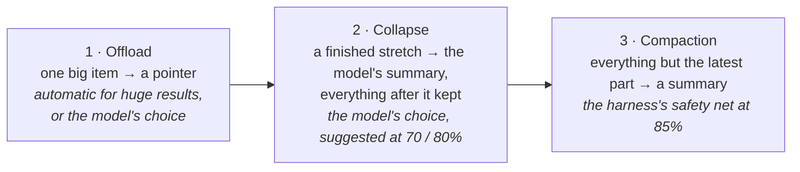
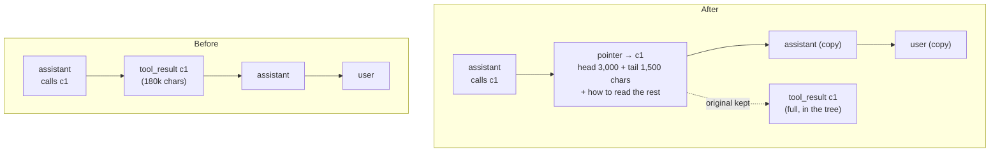
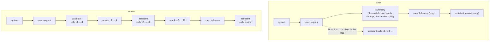
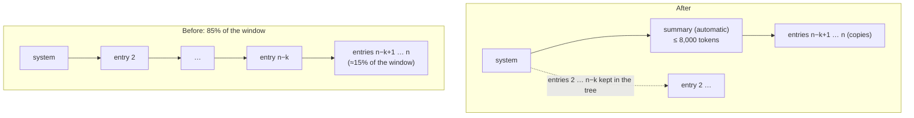
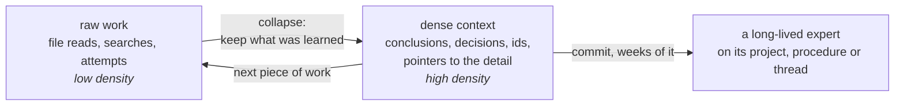
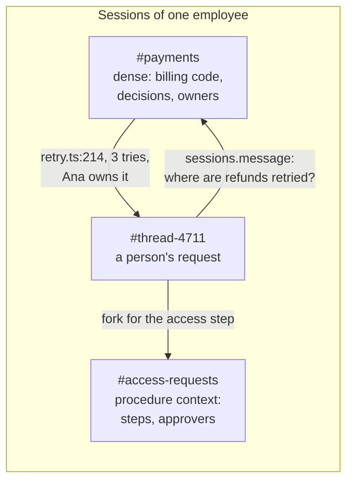
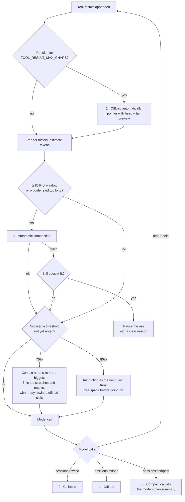
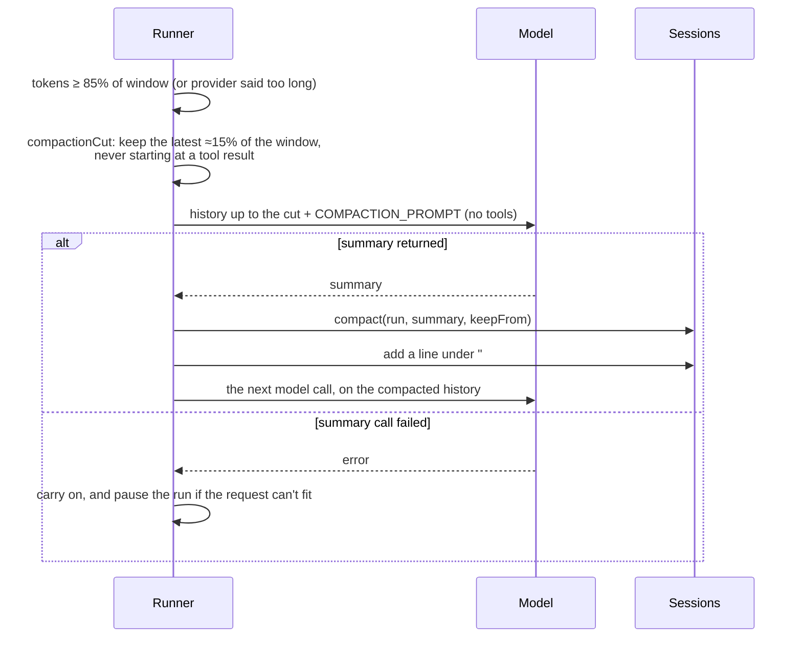

# Context management

An AI employee can own a piece of work for weeks: read a codebase, answer
follow-ups, come back after a pipeline fails. Its model only sees a fixed
window of tokens. This page explains how a session stays inside that window
without forgetting what matters. Concepts come first; the mechanics follow in
[How it works](#how-it-works).

The behaviour is specified in
[docs/spec.md](docs/spec.md#context-management-rewind-not-compaction), and the
entry tree in [docs/execution.md](docs/execution.md#history-as-an-entry-tree).

## The problem with classic compaction

The usual answer is **compaction**: when the context is nearly full, ask the
model to summarise the whole conversation, then replace the conversation with
the summary. It works, but it has four costs:

1. **It happens at the worst moment.** The model is in the middle of
   something, the context is at its fullest, and it has to summarise
   everything at once.
2. **Detail is lost for good.** Whatever isn't copied into the summary (an
   exact line number, an id, a quote someone asked for) is gone, and the work
   that depended on it quietly gets worse.
3. **Everything is treated the same.** A finished file read and the person's
   original request get the same lossy treatment.
4. **The cache is thrown away.** Providers cache the unchanged start of a
   prompt. Rewriting the whole conversation means the next call pays full
   price for everything.

## The concepts

### Nothing is ever deleted

A session's history is an **append-only tree** of entries. Freeing context
never deletes or edits anything. It builds a new, shorter path through the
tree, and the old path stays where it was. "Removed" means "no longer on the
path the model sees". So every operation can be read back or undone, by the
model (`sessions.restore`, `sessions.contents`) or by a person in the web UI.

This changes the trade-off. When dropping something can't lose it, you can
drop things early and often.

### Free small things early, not everything late

Instead of one big rewrite at the end, context is freed in **small, targeted
steps while the work goes on**: this one big result, that finished stretch of
file reads. Each step removes something that is clearly done and leaves the
rest word for word.

### The model chooses what to forget, and gets help

The model knows which parts of its history still matter, and the harness
knows how big they are. So the harness **measures and suggests**, and the
model **decides and summarises**. At set fill levels the harness tells the
model how full its context is and names the biggest finished parts, with a
ready call to free each one. The model writes the summary while the material
is fresh and while it knows what the rest of the task needs.

### Summarise a part, keep the rest verbatim

A summary stands in only for the part it replaces. Everything before it and
everything after it stays exactly as it was: the person's request, later
messages, replies already sent, the current turn. Most of the context keeps
its full detail.

The one exception is a **request boundary**. When a new request arrives, a
finished earlier request (the message that asked for it, the work, the reply)
can be collapsed whole, so the next task starts with only what it needs. The
request being worked on is never summarised: a collapse that covers it, or
a message the person sent while the work went on, keeps it word for word
right after the summary.

### Keep the cached prefix

Everything before the first changed entry is byte-identical, so the provider's
prompt cache stays valid for it. Freeing something near the end of the
history costs little; rewriting from the start costs the most. That's another
reason to prefer small, local moves.

### Escalate only when needed

There are three moves, from the most local to the most drastic. The harness
falls back to the drastic one only when the gentler ones weren't used:

| | Offload | Collapse | Compaction |
|---|---|---|---|
| **Replaces** | one entry | a finished stretch of tool calls, or at a new request a whole finished request | all but the first entry and the latest part (`CONTEXT_COMPACT_KEEP`, 15% of the window) |
| **With** | a pointer and a preview | the model's own summary | a summary written by a separate call |
| **Who decides** | the harness (huge results) or the model | the model, prompted by notes | the harness (or the model, explicitly) |
| **Detail kept** | everything except that entry | everything outside the stretch | the first entry and the recent tail |
| **Cache kept** | up to that entry | up to the stretch | only the first entry |
| **Undo** | `restore` puts it back | each entry readable with `restore` | each entry readable with `restore` |

## The three algorithms

### 1 · Offload: swap one big thing for a pointer

**Idea.** One item dominates the context: a 180 KB log, a lockfile, a long
document. Put a **pointer** in its place. The pointer says what it was,
shows a preview, and says how to read the rest. The original stays in the
tree and can be read in pieces or put back.

It happens automatically for results too big to keep at all, and the model
can do it for anything it has read and no longer needs word for word.

**Offload to a doc.** The model can first write what matters into a docs
chapter, so the pointer reads "see doc *X*, chapter *Y*". That turns private
context into shared knowledge: other sessions read the chapter, and any of
them can correct it. The pointer isn't refreshed when the chapter changes, and
it doesn't need to be. What's offloaded isn't in the context, so nothing stale
is relied on, and following the pointer reads the chapter as it is now.
(`sessions.restore` brings back the original entry as it was, which is the
point of restore.)

### 2 · Collapse: replace finished work with what was learned

**Idea.** Work comes in stretches: twelve file reads to understand a module,
a round of trial and error on a failing test. Once a stretch is done, its raw
material is no longer needed, only what was learned from it. The model
replaces the stretch with **its own summary**, and everything after the
stretch stays word for word. This is the main move; the other two are the
fallbacks.

Two variants:

- **Jump back** drops everything after a point. It's for abandoning a dead
  end: the summary keeps what was tried and why it failed.
- **Collapse a finished request.** At a new request, an earlier request and
  everything done for it (its own collapses, the reply) become one summary of
  what the new work still needs. It's a collapse of collapses: its index lists
  the earlier summaries inside it, each with its own index, so every part
  stays findable. Work made of tasks stays bounded: each task starts from the
  prompt, short summaries of the tasks before, and its own request. It's
  suggested once per finished request, when they take 30% of the window
  (`CONTEXT_BOUNDARY_AT`).

### 3 · Compaction: the safety net

**Idea.** If the model kept working without freeing anything and the context
reaches 85%, the harness steps in. A separate model call summarises the
older part of the work. The history becomes the first entry (the prompt),
that summary, and the most recent entries word for word, so the model doesn't
lose track of what it was doing a moment ago.

Unlike classic compaction, it keeps the recent tail, it's recorded in the
session document, and the detailed history is still in the tree.

## Dense sessions that talk to each other

The three algorithms do more than keep one session alive. They change what a
long-lived session **is**, and with it how work is shared across sessions.

### Knowledge density

Think of a context as tokens spent per thing known. A fresh session that
reads twelve files to answer one question holds 40k tokens of raw material
for a few facts. After a collapse it holds the facts: the summary of what was
learned, with the line numbers and ids that matter. Repeat that over weeks of
work and the session's context becomes **dense**. Nearly every token is a
conclusion, a decision or a pointer, not raw material. Collapse is what makes
this possible. A classic compaction would also make the context short, but by
lossy averaging, all at once, under pressure. Collapse distils one finished
part at a time, written by the model that just did the work.

So a session owning a project, a procedure or a long thread turns into a
specialist that **already knows**: what the code does, who decided what, what
was tried and failed, where the detail is if it's needed again.

### Ask the session that knows

When work needs knowledge another session holds, the cheap path is not to
rebuild it but to **ask**:

- **Messages between sessions.** `sessions.message { to: "@employee#slug",
  text }` puts a message straight into another session as something to act
  on, and it answers the same way. The question and the answer are short.
  They carry conclusions, not the raw material behind them.
- **Routing to the owner.** The router forwards new requests to the session
  that owns that work (from its decision log), so a follow-up lands where the
  knowledge already is, not in a new session that starts from zero.
- **Forks start warm.** A fork of a dense context (a procedure context, a
  project session) starts out knowing everything it knows. Nothing has to be
  re-read, and every fork shares the same prefix, so the provider's prompt
  cache serves it.
- **Ephemeral runs keep experts small.** A long-lived context handles a
  passing event in a run that's thrown away afterwards, and commits only what
  is worth keeping. It stays dense for months instead of growing with every
  question it answered.

### Why it's cheaper

Answering "where are refunds retried?" from scratch means a session reads
the code again: tens of thousands of tokens of file reads, every time
someone asks. Asking the session that already collapsed that reading costs
its prompt (mostly a cached prefix) plus a short question and answer. The
knowledge is paid for once, kept dense, and reused by everyone who asks.

| | Fresh session per question | Ask a dense session |
|---|---|---|
| Raw material read | every time | once, then collapsed |
| Tokens per answer | the whole reading again | a cached prefix + a short Q&A |
| What the asker's context gains | raw material it must collapse itself | a conclusion, a few lines |
| Knowledge over time | starts from zero each time | accumulates, and stays dense |

Each session keeps its own slice dense, and what crosses between them is
distilled. That's how a few dense contexts can cover a whole company without
any of them running out of room.

**What the benchmark says so far** ([the benchmark](#benchmark)). Asking the
session that read everything is now the cheapest way to look things up by id:
22–62k for five lookups, against about 280k for a fresh session that reads
them again. Before `sessions.search` it wasn't: one lookup cost 159k, more
than a fresh session's 27–29k. Lookups in other words than the source's are
even so far. Detail that can't be read again (messages, events, results that
changed) is where only the dense session can answer at all.

## Benchmark

**Current result** (third round, 2026-10-14): on one long task, managed is
**13–57% cheaper** on the report than classic compaction, and the gap grows
with the facts the task has to keep (managed's cost stays nearly flat,
classic's summaries and compactions grow). Managed never lost a fact;
classic lost one that a late correction made relevant after it was
summarised. Lookups by id cost managed **a fifth to a tenth** of re-reading
(22–62k against about 280k). On a one-time source, classic couldn't answer
at all. The rounds below show how we got there, including where classic won.

`npm run bench:context` ([packages/evals](packages/evals/README.md#the-context-benchmark))
runs one long task under different strategies, with the same model, archive
and window. The task: read a paged incident archive (20 pages, about 206k
characters, roughly three times the window) one page at a time, then report
the audit reference from page 1 and the 12 incidents whose final severity is
SEV1 (corrections on later pages change four of them), each with its exact
root-cause location and on-call engineer. Afterwards, the same session gets a
**follow-up** about details of a minor incident on page 3 that nobody asked
for before (its ticket and deploy id).

| arm | strategy |
|-----|----------|
| `classic` | classic compaction: at 85% everything is summarised; no notes, no context tools |
| `safety-net` | our automatic compaction alone: at 85%, keeping the latest 15% verbatim |
| `managed-early` | everything, with notes at 50% and 75% (the default before the benchmark) |
| `managed` | everything, as deployed: a note at 70%, the free-space turn at 80%, the context tools (`sessions.rewind`, `offload`, `restore`, `compact`, `contents`, `search`¹), compaction at 85% |

¹ Rounds one and two ran without `sessions.search`. The note at a request
boundary came after the third round (`bfed127`); it fires only when there is
more than one request, so the single-request rounds wouldn't have used it.

A **fresh session** baseline asks the same follow-up of a new session that
starts from zero, as the cost of not asking the session that already read the
archive.

### First results (2026-10-13)

Claude Sonnet 5.5, a 64k window, three runs per arm. Figures are medians,
with the range when the runs differ. **Billed-equivalent** weighs tokens by
price, in uncached input tokens: cached reads ×0.1, output ×5. Cache writes
(×1.25) aren't reported by the provider, so billed-equivalent is a lower
bound.

| arm | report correct | prompt tokens | cached | billed-equivalent | collapses | restores | time | follow-up right | follow-up billed |
|-----|----------------|---------------|--------|-------------------|-----------|----------|------|-----------------|------------------|
| classic | 12/12 (3/3 runs) | 657k | 65% | 308k | 0 | 0 | 64 s | 3/3 | 30k |
| safety-net | 12/12 (3/3) | 684k | 67% | 311k | 0 | 0 | 66 s | 3/3 | 35k |
| managed-early | 12/12 (3/3) | 818k (743k–826k) | 62% | 418k (371k–420k) | 6 | 10 | 105 s | 3/3 | 65k (38k–269k) |

**Classic compaction wins this task**, by about a third on billed cost.
Everything the report needs is twelve short lines, so any summary keeps it,
and the archive can be read again, so the follow-up costs three page reads.
What we saw in the managed-early arm (round one's only managed arm):

- **It collapses too early and too often.** A page is about 5.5k tokens, so
  five pages fill about 45% of the window. The 50% note suggests collapsing
  them; the collapse drops the context by more than the 15-point re-arm
  margin, which arms the 50% note again, and the cycle repeats. Each collapse
  costs output (the summary) and a context the cache hasn't seen.
- **It distrusts its own summaries.** In two of three runs, after a few
  collapses, the model listed what it had collapsed and read entries back one
  by one. The task asks for exact values and later pages carry corrections,
  and a free-form summary doesn't say whether it kept everything exactly.
- **The follow-up was answered from its own history** in two runs (three or
  five restores). In the third, the model didn't know which collapsed stretch
  held page 3, so it read 16 pages again (269k billed).

### What changed after the first round

- **Collapse summaries carry an index.** The harness appends one line per
  replaced tool call, with its arguments and the entry holding its result
  (`- archive.read_page {"page":3,…} → entry ent_… (≈5.5k tokens)`), so a
  later question reads back the one result it needs.
- **The summary is authoritative.** The tool asks for exact values copied
  verbatim, and its result says the summary now stands for the stretch: rely
  on it, and read entries back only for a detail it lacks.
- **Restores show their cost** ("adds about 5.5k tokens to your context").
- **Fewer notes:** the `managed` arm has a single note at 70%
  (`CONTEXT_NOTES=70`, now the default); `managed-early` keeps 50% and 75%.
- **A one-time source** (`--source feed`): each page can be read once, so a
  follow-up can only be answered from the session's own history, and a
  **fresh session** baseline asks the same follow-up from zero.

### Second round (2026-10-13)

The same task, with the collapse index, authoritative summaries and restore
costs, and with the `managed` arm (one note at 70%) next to `managed-early`.
On the **archive**,
pages can be read again; on the **feed**, each page can be read once, so the
follow-up (the ticket and deploy id of a minor incident on page 3) can only
be answered from what the session kept.

Follow-up figures count only runs that finished; a run the harness failed is
counted on its own, not as a wrong answer.

| source | arm | report correct | calls | billed-equivalent | collapses | restores | time | follow-up right | follow-up billed | harness failures | fresh session |
|--------|-----|----------------|-------|-------------------|-----------|----------|------|-----------------|------------------|------------------|---------------|
| archive | classic | 12/12 (3/3 runs) | 23 | 310k | 0 | 0 | 70 s | 3/3 | 30k | 0 | 3/3, 27k |
| archive | safety-net | 12/12 (3/3) | 23 | 311k | 0 | 0 | 69 s | 3/3 | 34k | 0 | 3/3, 27k |
| archive | managed | 12/12 (3/3) | 21 | **265k** | 2 | 0 | 57 s | 2/2 | 159k (104k–215k) | 1 | 3/3, 29k |
| archive | managed-early | 12/12 (3/3) | 29 | 410k (355k–431k) | 5 | 0 | 102 s | 3/3 | 126k (48k–221k) | 0 | 3/3, 28k |
| feed | classic | 12/12 (3/3) | 23 | 306k | 0 | 0 | 88 s | **0/3, all abstained** | 4k | 0 | can't: pages consumed |
| feed | safety-net | 12/12 (3/3) | 23 | 316k | 0 | 0 | 72 s | **0/3, all abstained** | 5k | 0 | can't: pages consumed |
| feed | managed | 12/12 (3/3) | 21 | **267k** | 2 | 0 | 56 s | 2/2 | 65k (42k–87k) | 1 | can't: pages consumed |
| feed | managed-early | 12/12 (3/3) | 27 | 401k (267k–456k) | 6 | 10 | 108 s | **3/3** | 64k (40k–183k) | 0 | can't: pages consumed |

- **One late note beats two early ones.** With a single note at 70%, the
  model collapses twice, in big pieces, never restores, and never reaches
  compaction: **15% cheaper than classic compaction** on billed cost, and
  faster. `managed-early` still churns: on the feed it read back 10 and 12
  collapsed entries during the report in two of three runs (0 in the third),
  as in the first round, so it's a habit of that arm, not one bad run.
  `CONTEXT_NOTES` now defaults to 70.
- **Detail that can't be read again is where classic compaction fails.** On
  the feed, classic and safety-net answered the follow-up wrong in all six
  runs: the summary had no reason to keep a minor incident's ticket, and
  nothing else held it. They failed honestly: every one of the six answers
  said the details weren't in its notes and that it wouldn't guess, none
  invented a ticket. Both managed arms answered from their own history.
- *(Superseded in round three, with `sessions.search`.)* **A fresh session is the cheapest way to answer a targeted lookup when the
  source can be read again.** On the archive, a new session answered the
  follow-up for 27–29k, less than every arm: classic's re-read (30k), and
  far less than the managed arms answering from history (126k–159k). A new
  session has a small context, finds the incident in three page reads, and
  stops; a long session pays for its whole context on every call, cached or
  not. So "ask the session that knows" (above) doesn't hold for this case.
  What the data supports so far: the dense session wins when the detail
  **can't** be read again (the feed, where a fresh session can't answer at
  all, and classic abstained), not as a cheaper lookup.
- *(Superseded in round three, with `sessions.search`.)* **Answering from history still costs more than re-reading** when
  re-reading is possible. The question names an incident, not a page, and an
  index of arguments (`read_page {page: 3}`) doesn't say where the incident
  is, so the model browsed `sessions.contents` and restored page after page.
  The benchmark also left out `sessions.search`, which the deployed toolset
  has. Fixed since: the context tools include `sessions.search`, which
  searches the session's own history, collapsed parts included, and each hit
  comes with a ready `restore { entryId, offset, length }` that reads the
  text around the match.
- **Two harness failures:** a `managed` follow-up run failed right after a
  `sessions.rewind` that reached back into the earlier run (archive), and
  another before its first model call (feed). They're harness errors, not
  model ones; the benchmark now records the error and the app's warnings so
  they can be fixed. The archive `managed` follow-up figure is over the two
  runs that finished.

### Third round: scaling the facts (2026-10-14)

The same 20 pages, with more facts the report has to keep exactly: 12, 40, 80
and 150 SEV1 incidents. After the report, **five follow-ups by id** (minor
incidents on pages spread across the archive) and **three fuzzy follow-ups**
(an incident described in other words, without its id: "the media-cdn
incident where background jobs piled up and stopped moving, because two cache
entries ended up with the same key"). Every run at commit `ddf1143`, with
`sessions.search` and the 70% note. Three runs per arm and size; medians.

| facts | arm | report correct | prompt tokens | billed-equivalent | compactions | collapses | time | 5 follow-ups by id, billed | 3 fuzzy, right, billed |
|-------|-----|----------------|---------------|-------------------|-------------|-----------|------|----------------------------|------------------------|
| 12 | classic | 12/12 (3/3 runs) | 656k | 312k | 2 | 0 | 69 s | 15/15, 276k | 9/9, 322k |
| 12 | managed | 12/12 (3/3) | 659k | **270k** (−13%) | 0 | 3 | 56 s | 15/15, **22k** | 6/9¹, 233k |
| 40 | classic | 40/40 in 2 runs, 39/40 in 1² | 983k | 478k | 3 | 0 | 116 s | 15/15, 282k | 9/9, 327k |
| 40 | managed | 40/40 (3/3) | 644k | **273k** (−43%) | 0 | 3 | 81 s | 15/15, **30k** | 9/9, 271k |
| 80 | classic | 80/80 (3/3) | 1009k | 522k | 3 | 0 | 156 s | 15/15, 270k | 9/9, 297k |
| 80 | managed | 80/80 (3/3) | 692k | **313k** (−40%) | 0 | 4 | 104 s | 15/15, **48k** | 9/9, 285k |
| 150 | classic | 150/150 (3/3) | 1360k | 755k | 4 | 0 | 264 s | 15/15, 291k | 9/9, 290k |
| 150 | managed | 150/150 (3/3) | 703k | **325k** (−57%) | 0 | 5 | 127 s | 15/15, **62k** | 9/9, 435k |

A **fresh session** answering the same five follow-ups from zero: 30/30 right,
278–281k billed at every size (range 254k–303k, about 15% run to run: the
noise floor for the other comparisons).

¹ One run lost the question: it collapsed a stretch that included the fuzzy
question itself, then answered with its earlier report. Fixed since: a request made in the current run is
kept word for word after a collapse that covers it.
² One run lost an incident a correction on page 16 upgraded to SEV1: its
record was on an early page, and the summary had no reason to keep a minor
incident. The model said so ("its original record is not in the archive, so
I have no file:line or on-call"), and left it out.

- **The managed report costs about the same at any size; classic's grows.**
  Managed: 270k → 325k from 12 to 150 facts. Classic: 312k → 755k. Classic
  re-summarises everything at each compaction, and its summaries grow with
  the facts (about 3.5k tokens each at 12 facts, 5.5k at 80, 7.3k at 150, just
  under the 8,000-token cap), so each compaction costs more and comes sooner.
  At 150 it needed a fourth. The gap is 40–43% at 40–80 facts and 57% at 150.
- **Classic lost what became relevant late.** At 40 facts, a correction on
  page 16 upgraded an incident to SEV1 whose record was on an early page.
  Classic's summary had no reason to keep a minor incident, so by then its
  location and engineer were gone; the model said so ("its original record
  is not in the archive, so I have no file:line or on-call") and left it
  out. Managed, whose original entries stay findable, never lost one. That's
  the failure people meet in practice: a detail that looked unimportant when
  it was summarised turns out to matter, inside the main task, not in a
  follow-up.
- **Otherwise classic stays accurate, and pays for it.** 150 facts was close
  to its limit: summaries of about 7.3k of the 8,000 tokens the summary call
  may write. That commit (`ddf1143`) didn't have the retry for a cut-off
  summary yet (it came in `bfed127`), and none was cut: every classic report
  at 150 facts had all 150.
- **Lookups by id: the session that read everything is the cheapest.** 22–62k
  for five follow-ups, against 270–291k for classic (which re-reads) and
  278–281k for a fresh session. `sessions.search` is what changed: in round
  two, without it, one follow-up cost the same arm 159k.
- **Fuzzy lookups are even, not won.** Both arms got 9/9 from 40 facts on;
  managed was cheaper up to 80 facts and dearer at 150 (435k vs 290k).
  Without the id, search had to match the record's own words, and the
  description used others; the model fell back to restoring or re-reading
  pages. Fixed since: a search that finds no entry with every word ranks
  entries by how many of the words they have, and its ready read starts where
  they come together. Not measured yet.

### Chains of tasks (2026-10-14)

Five tasks in one session (`--chain 5`), each auditing its own five pages of
a 25-page archive, and from the second on asked about an incident from the
task before. Commit `bfed127`, three runs per arm.

| task | classic billed | managed billed | classic context at end | managed context at end |
|------|----------------|----------------|------------------------|------------------------|
| 1 | 47k | 51k | 33k | 36k |
| 2 | 113k | 115k | 12k | 38k |
| 3 | 144k | 141k | 7k | 25k |
| 4 | 161k | 87k | 29k | 55k |
| 5 | 163k | 134k | 28k | 39k |

Every task right in both arms, the questions about earlier tasks included.
Managed is **16% cheaper over the chain** (about 528k against 628k), but the
gap doesn't grow with the number of tasks. On this shape classic's single
compaction per task acts like a collapse of the finished task: the tasks
share one fact each, so its summary stays small. The note at a new request
didn't lead to a collapse at the boundary; the model carried on into the
70% and 80% notes. A chain whose tasks build on each other is still to test.

### Instructions during the work (2026-10-14)

`--instructions`: while the report (40 facts) is written, the person sends a
constraint after page 4 ("leave out every billing-worker incident, those go
to a separate review") and after page 12 a correction that doesn't name the
service again ("keep those after all, marked (review)"). Commit `a540240`.

| arm | instructions followed | billed-equivalent | compactions | collapses |
|-----|-----------------------|-------------------|-------------|-----------|
| classic | 3/3 runs | 496k | 3 | 0 |
| managed | 3/3 runs | 555k | 2–3 | 0 |

- **Classic kept both instructions** through its compactions: its summary
  prompt asks for decisions and who asked, and it carried the constraint
  and the correction.
- **Managed couldn't collapse at all**, and paid more for it. Its rewind at
  80% covered the person's constraint, and the harness refused a collapse
  that would replace a request made in the run. The model didn't try again
  around it, so automatic compaction took over. Fixed since: the request is
  kept word for word right after the summary instead (better than any
  paraphrase), and the collapse goes ahead. Not measured yet.

Still to test: instructions with the request carried through a collapse,
fuzzy lookups with the passage-ranked search, chains of tasks that build on
each other, and long-lived sessions that hit the cache over weeks.

## How it works

The code is in `packages/runner/src/context-window.ts` (pure decisions),
`packages/runner/src/runner.ts` (when they run) and
`packages/sessions/src/sessions.ts` (`offload`, `restore`, `rewind`,
`compact`).

### The loop

Before every model call the runner measures the request and decides what to
do:

| Percent | Setting | What happens |
|---------|---------|--------------|
| any | `TOOL_RESULT_MAX_CHARS` (20,000) | oversized results are offloaded as they arrive |
| new request | `CONTEXT_BOUNDARY_AT` (30) | finished earlier requests take ≥ 30% of the window: a note with ready calls to collapse each whole |
| 70% | `CONTEXT_NOTES` | an advisory `system` note with up to three suggestions |
| 80% | `CONTEXT_NEAR_AT` | a `user` turn: free space now (collapse, or compact with your own summary) |
| 85% | `CONTEXT_COMPACT_AT` | automatic compaction before the next model call |
| over the window | — | compaction is tried once more; if it fails, the run pauses |

- **Measuring.** The window comes from the model name (a table of known
  models, 128k otherwise) or `MODEL_CONTEXT_TOKENS`. Tokens are estimated
  from the request's characters, using the chars-per-token ratio measured at
  the run's last model call (3.5 before the first).
- **Notes don't nag.** Each threshold is noted once. It re-arms only after the
  context falls 15 points below it (a compaction or a big collapse), not on
  the small dips an offload causes. Notes are `transient`: they describe the
  context as it was, so a collapse or compaction never copies them into the
  part it keeps. A note never goes between a tool call and its result.
- **At a new request** (`earlierTasks`), the history before the run's own
  request is split into finished requests: each from its message to the entry
  before the next one (the harness's notes don't count towards its size). If
  they take `CONTEXT_BOUNDARY_AT` (30%) of the window, the run's first call
  gets a note naming the biggest, with ready `sessions.rewind { from, to,
  summary }` calls. It fires once per finished request: the note records the
  requests it named, and a later request gets one only if some finished
  request hasn't been named yet, so a model that kept its finished work isn't
  told again. The first entry (the prompt) is never part of a request, so it
  stays first, and the cached prefix is the prompt plus the earliest summary.
- **Picking suggestions** (`contextSuggestions`). Walk the history up to the
  latest tool-call turn (that's still current work). Group consecutive
  tool-call turns into stretches; notes between them don't break a stretch,
  a message does. Drop stretches with a call still waiting for its result.
  Rank stretches and single results by estimated tokens, drop anything under
  2% of the window, and keep at most three: mostly stretches, plus the
  biggest single result.

### Offload

- **Automatic:** a result longer than `TOOL_RESULT_MAX_CHARS` is stored in
  full and kept in the history as its first 3,000 and last 1,500 characters,
  with the instruction to call `sessions.restore { entryId, offset, length }`
  to read pieces, or without them to put the whole result back. Results with
  images are left alone.
- **By the model:** `sessions.offload { entryId, text }`, optionally pointing
  to a docs chapter it wrote first.
- **In the tree:** a `pointer` entry is created next to the original, with
  the same tool call id, so the history is still a valid tool exchange. The
  entries after it are re-created on top with the same content hashes, which
  is cheap, but the cached prefix is invalid from the pointer on. That's why
  it's best on older, larger entries.

### Collapse

- **Named by tool call ids.** Every tool result the model sees starts with
  `[call <id>]`, so it can say `sessions.rewind { from: "c1", to: "c12",
  summary }`. The notes hand it ready-made calls.
- **Tool calls stay whole.** A stretch never splits a call from its results,
  and a call still waiting for its result can't be collapsed. Kept results
  whose call was collapsed bring a copy of their assistant entry with only
  those calls.
- **Any point.** The stretch may lie in earlier runs of a continuing session.
- **Jump back:** `sessions.rewind { from, summary }` without `to`.
- **In the tree:** a `summary` entry hangs off the entry before the stretch,
  and the entries after the stretch are re-created on top of it.

### Compaction

- **The summary prompt** asks for the goal and who asked, decisions, the
  current state, what's left, and verbatim whatever the rest needs (line
  numbers, quotes, figures, ids, paths, links), in about 2,000 words.
- **The kept tail:** 15% of the window (`CONTEXT_COMPACT_KEEP`), or of the request when
  that's smaller. It never starts with a tool result: a result whose call is
  summarised is summarised with it.
- **Recorded:** the summary entry is marked `automatic`, the session document
  keeps the latest five compactions under "Compactions", and
  `sessions.contents` lists it with ready `restore` calls for the entries it
  replaced.
- **Provider quirks:** if a provider refuses the summary call without the tool
  definitions, it's retried once with them.
- **A summary cut off at its limit** (8,000 tokens) is asked for again with
  twice the room. If it's still cut, it's kept with a note saying its end is
  missing, rather than silently losing it.
- **A history change that fails** (a rewind, offload or compaction that can't
  be applied) leaves the history as it was and tells the model; the run goes
  on. Only an outage stops it, to be retried.
- **By the model:** `sessions.compact { summary }`, which the 80% instruction
  offers as an alternative to collapsing.

### Run modes

All three change the **run's** history, even when they reach into earlier
runs. A continuing run commits it, so the session carries on from the shorter
history. An ephemeral run (router, triggers) leaves the session as it was.

### Settings

| Variable | Default | |
|----------|---------|---|
| `MODEL_CONTEXT_TOKENS` | from the model table, else 128k | the window |
| `CONTEXT_COMPACT_AT` | 85 | percent for automatic compaction; 0 turns it off |
| `CONTEXT_NEAR_AT` | 80 | percent for the "free space now" turn; 0 turns it off |
| `CONTEXT_NOTES` | 70 | percents for the advisory notes, comma-separated; `off` turns them off |
| `CONTEXT_BOUNDARY_AT` | 30 | percent of the window finished earlier requests must take for the note at a new request; 0 turns it off |
| `CONTEXT_COMPACT_KEEP` | 0.15 | share of the window an automatic compaction keeps verbatim; 0 summarises everything |
| `TOOL_RESULT_MAX_CHARS` | 20000 | automatic offload of big results; 0 turns it off |

The 8,000-token summary limit is a runner option (`compactSummaryMaxTokens`).
