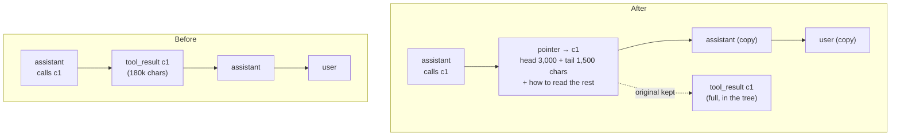
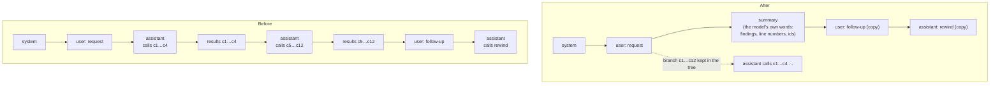
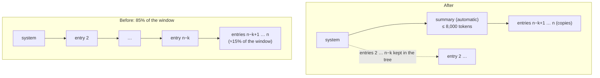
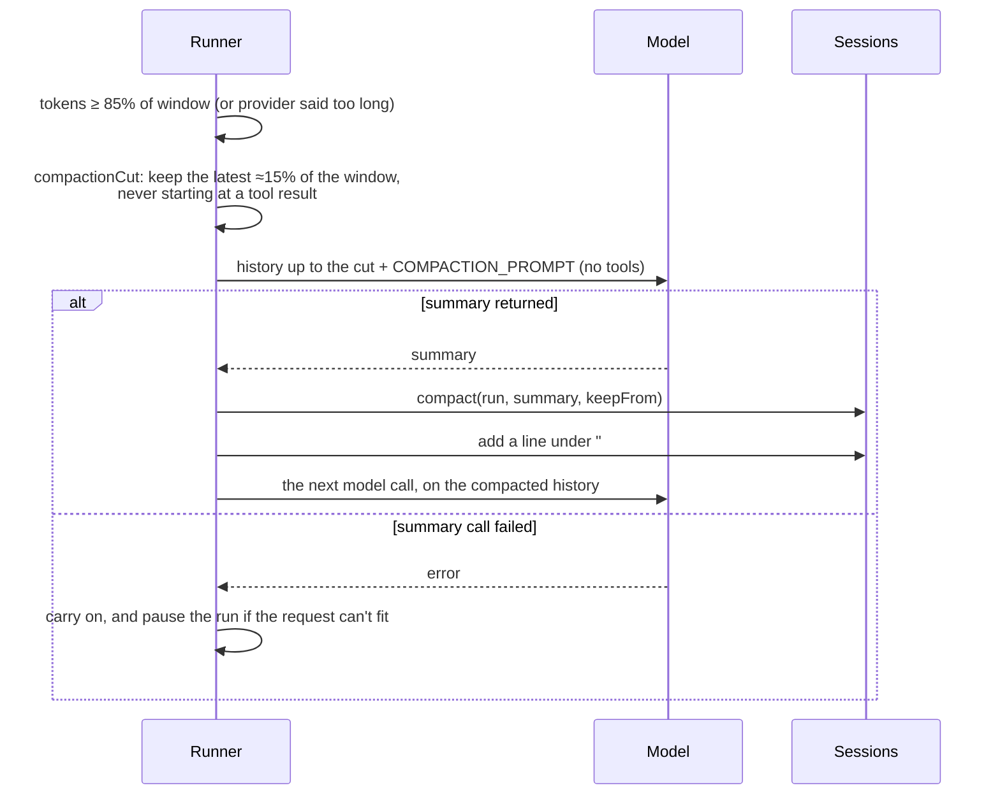

# Context management

How a session keeps its context window from filling up without losing
anything. The behaviour is specified in
[docs/spec.md](docs/spec.md#context-management-rewind-not-compaction) and the
entry tree in [docs/execution.md](docs/execution.md#history-as-an-entry-tree);
this page explains the three algorithms and how they fit together. The code is
in `packages/runner/src/context-window.ts` (pure decisions),
`packages/runner/src/runner.ts` (when they run) and
`packages/sessions/src/sessions.ts` (`offload`, `restore`, `rewind`,
`compact`).

## The idea

Classic compaction waits until the context is full, then summarises the whole
conversation and throws the original away. It's one blunt move at the worst
moment: the summary is written under pressure, everything that wasn't copied
into it is gone, and the cached prompt prefix is invalidated in full.

Here, context is freed in small, targeted steps while the work goes on, by the
party that knows best what is still needed:

| # | Algorithm | What it frees | Who triggers it | Cache impact |
|---|-----------|---------------|-----------------|--------------|
| 1 | **Offload** | one big message or tool result, replaced by a pointer with a preview | the harness (results over 20,000 chars), or the model (`sessions.offload`) | prefix valid up to that message |
| 2 | **Collapse** (rewind) | a finished stretch of tool calls, replaced by the model's own summary; everything after it stays verbatim | the model (`sessions.rewind { from, to, summary }`), prompted by context notes | prefix valid up to the stretch |
| 3 | **Compaction** | everything but the first entry and the latest ~15% of the window | the harness at 85% (safety net), or the model (`sessions.compact`) | prefix valid only for the first entry |

All three are **non-destructive**. History is an append-only tree of entries;
an operation creates new entries and moves the run's `tip`. The originals stay
in the database and can be read back (`sessions.restore`,
`sessions.contents`), by the model or in the web UI.

## When each one runs

Before every model call the runner measures the request and decides what to do:

The thresholds as the context grows:

| Percent | Setting | What happens |
|---------|---------|--------------|
| any | `TOOL_RESULT_MAX_CHARS` (20,000) | oversized results are offloaded as they arrive |
| 50%, 75% | runner `contextNotes` | an advisory `system` note with up to three suggestions |
| 80% | `CONTEXT_NEAR_AT` | a `user` turn: free space now (collapse, or compact with your own summary) |
| 85% | `CONTEXT_COMPACT_AT` | automatic compaction before the next model call |
| over the window | — | compaction is tried once more; if it fails, the run pauses |

The window comes from the model name (a table of known models, 128k
otherwise) or `MODEL_CONTEXT_TOKENS`. Token counts are estimated from the
request's characters, using the chars-per-token ratio measured at the run's
last model call (3.5 before the first).

**Notes don't nag.** Each threshold is noted once. It re-arms only after the
context falls 15 points below it (a compaction or a big collapse), not on the
small dips an offload causes. Notes are marked `transient`: they describe the
context as it was, so a collapse or compaction never copies them into the part
it keeps. A note never goes between a tool call and its result.

## 1 · Offload

One entry is replaced by a **pointer**. The pointer keeps the tool call id, so
the history is still a valid tool exchange for the provider.

- **Automatic:** a result longer than `TOOL_RESULT_MAX_CHARS` is stored in full
  and kept in the history as its first 3,000 and last 1,500 characters, with
  the instruction to call `sessions.restore { entryId, offset, length }` to
  read pieces, or without them to put the whole result back. Results with
  images are left alone.
- **By the model:** `sessions.offload { entryId, text }` for anything it
  read and no longer needs verbatim, optionally pointing to a docs chapter it
  wrote first.
- **Cost:** the entries after the pointer are re-created on top of it. Their
  content is stored by hash, so that's cheap, but the cached prefix is invalid
  from the pointer on. Best on older, larger entries.
- **Reversible:** `sessions.restore { entryId }` puts the original back.

## 2 · Collapse (rewind)

The main move. When a part of the work is done (say, twelve file reads to
understand a module), the model replaces that stretch with a summary of what
it learned. Everything after the stretch (people's later messages, replies it
already sent, its current turn) stays word for word.

- **Named by tool call ids.** Every tool result the model sees starts with
  `[call <id>]`, so it can say `sessions.rewind { from: "c1", to: "c12",
  summary }`. The context notes hand it ready-made calls for the biggest
  finished stretches.
- **Tool calls stay whole.** A stretch never splits a call from its results,
  and a call still waiting for its result can't be collapsed.
- **Jump back:** with only `from`, everything after that point is replaced by
  the summary. That's for abandoning a dead end.
- **Any point:** the stretch may lie in earlier runs of a continuing session.
- **Why it's better than a summary at the end:** the model writes the summary
  while the material is fresh and while it knows what the rest of the task
  needs, and it summarises one finished part, not everything at once.
- **Cache:** everything before the stretch is unchanged, so its cached prefix
  stays valid.

How the suggestions are picked (`contextSuggestions`): walk the history up to
the latest tool-call turn (still current work), group consecutive tool-call
turns into stretches (notes between them don't break a stretch; a message
does), drop stretches with a call still waiting, and rank stretches and single
results by estimated tokens. Things under 2% of the window aren't suggested.
At most three: mostly stretches, plus the biggest single result.

## 3 · Compaction

The safety net, for when the model didn't free enough. One extra model call,
without tools, writes a summary of the work so far: the goal and who asked,
decisions, current state, what's left, and verbatim whatever the rest needs
(line numbers, quotes, figures, ids, paths, links). The history becomes the
first entry, that summary, and the latest entries verbatim.

- **The kept tail:** 15% of the window (`compactKeep`), or of the request when
  it's smaller. It never starts with a tool result: a result whose call is
  summarised is summarised with it.
- **Recorded:** the summary entry is marked `automatic`, the session document
  keeps the latest five compactions under "Compactions", and
  `sessions.contents` lists it with ready `restore` calls for the entries it
  replaced.
- **Provider quirks:** if a provider refuses the summary call without the tool
  definitions, it's retried once with them.
- **The model can do it too:** `sessions.compact { summary }` with its own
  summary, which the 80% instruction offers as an alternative to collapsing.

## Run modes

All three change the **run's** history, even when they reach into earlier
runs. A continuing run commits it, so the session carries on from the shorter
history. An ephemeral run (router, triggers) leaves the session as it was.

## Settings

| Variable | Default | |
|----------|---------|---|
| `MODEL_CONTEXT_TOKENS` | from the model table, else 128k | the window |
| `CONTEXT_COMPACT_AT` | 85 | percent for automatic compaction; 0 turns it off |
| `CONTEXT_NEAR_AT` | 80 | percent for the "free space now" turn; 0 turns it off |
| `TOOL_RESULT_MAX_CHARS` | 20000 | automatic offload of big results; 0 turns it off |

The 50% and 75% notes, the 15% kept tail and the 8,000-token summary limit
are runner options (`contextNotes`, `compactKeep`, `compactSummaryMaxTokens`).
